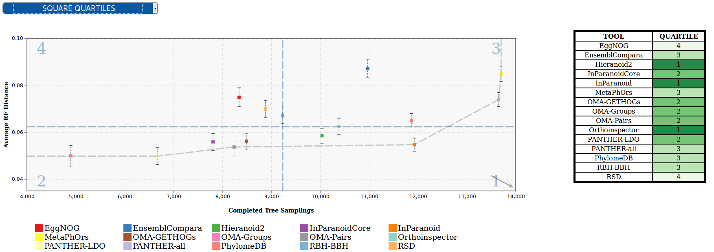
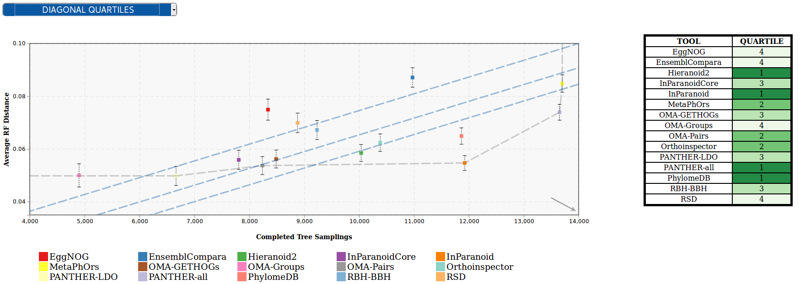
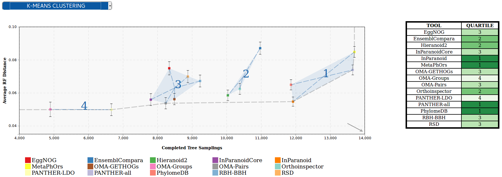

# OpenEBench Scientific Benchmarking visualizer
Repository that contains the code required to visualize results from scientific benchmarking experiments in plot format, and apply several classification methods in order to transform them to tabular format.

## NPM Package
NPM Package `@inb/oeb-chart-scatter` published to: https://www.npmjs.com/package/@inb/oeb-chart-scatter

## Data Input
The visualizer uses as input the results of one challenge stored in the OpenEBench database in the format of the official [Benchmarking Data Model](https://github.com/inab/benchmarking-data-model).

Per default it consumes the [OpenEBench Sci-API](https://openebench.bsc.es/sciapi/) (deprecated).

It is also able to consume the new API [OpenEBench API Scientific](https://dev-openebench.bsc.es/api/scientific/). 
The API can be set by supplying the following attribute: `data-api-url="{{ API_URL }}"`

## Branches
* master: Python visualizer scripts 
* js: JavaScript visualizer project

## Classification methods
* Square quartiles - divide the plotting area in four squares by getting the 2nd quartile of the X and Y metrics.

* Diagonal quartiles - divide the plotting area with diagonal lines by assigning a score to each participant based in the distance to the 'optimal performance'.

* Clustering - group the participants using the K-means clustering algorithm and sort the clusters according to the performance.



## How to use

The component can be imported in two way: As npm package (preferred), or via the build file from the git repository (see bottom).

### Use the npm package

`npm i @inb/oeb-chart-scatter`

In your frontend component:
`import { load_scatter_visualization } from "@inb/oeb-chart-scatter";`

```                          
          <div
              data-id="{{ ID }}"
              class="benchmarkingChart_scatter"
              data-api-url="{{ API_URL }}"
              toTable="true"
          ></div>
```

You can then call the `load_scatter_visualization()` function.

### Attributes that can be set on the _<div\>_ tag

-   data-id : the official OEB id of the aggregation dataset you want to visualize.
-   toTable: should be set to true/false depending whether you want to view the classification table in the right or not.
-   class: should always be *'benchmarkingChart_scatter'*
-   data-api-url: Should always contain the full API URL e.g. https://openebench.bsc.es/api/scientific/graphql

### Alternative way: Clone from repository

Requirements:

-npm
-http server

Clone the repo to your document root :
```
git clone https://github.com/inab/OpenEBench_scientific_visualizer.git
```

Install dependencies from package.json :
```
npm install 
```

Build with webpack (Node.js >= 20):
```
npm run prod   # minified build/build.js
npm run dev    # development build, rebuilds on changes
```
`build/build.js` is self-contained (d3, html2canvas and jsPDF are bundled; jQuery is no longer used),
so only the build file needs to be included in your html. The charts are drawn automatically on page
load; `load_scatter_visualization()` can be called to draw them again.

The HTML file should look like [this](./index.html)


## Live Demo
See a demo of how this visualizer works [here](https://inab.github.io/OpenEBench_scientific_visualizer/)


